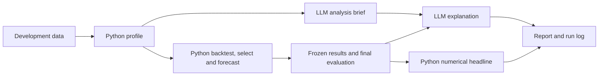

# Module 1: From a forecasting notebook to an agentic workflow

Status: initial plan, awaiting independent critique.

## 1. Purpose and teaching claim

Build the first Substack post and companion notebook in a series about agentic time-series forecasting. Introduce **prompt chaining / sequential workflow** through an executable example whose control flow remains explicit. This is an LLM-assisted workflow with fixed stages; later modules introduce adaptive tool choice, routing, planning, and delegation.

The central question is: **What does an LLM-assisted workflow add when the forecasting calculations already work?** The intended contribution is structured interpretation and communication. Forecast accuracy is measured, but an accuracy improvement is neither expected nor required when the numerical path is identical.

Readers should be comfortable with pandas, train/test splits, and elementary forecasting. By the end they should be able to extract reusable forecasting functions from a notebook, pass structured evidence between stages, inspect a run log, and distinguish deterministic computation from language generation.

## 2. Choose a deliberately small forecasting problem

Use [`data/passengers.csv`](../data/passengers.csv): 144 observations from January 1949 through December 1960, columns `date` and `passengers`. A local audit found no duplicate months or empty target values. Validate the full monthly grid, numeric values, and positivity during implementation.

Task: forecast the next 12 months of one series. Use the CSV's native units and label them clearly; confirm units against provenance before making a more specific unit claim.

Start from the passenger examples and exponential-smoothing code in [`m02-smoothing-methods.ipynb`](../m02-smoothing-methods.ipynb), and reuse the conceptual stage separation and reporting failure from [`m16-agents.ipynb`](../m16-agents.ipynb).

Why change the earlier energy example: `data/us_energy.csv` has 486 rows with irregular date stamps and multiple observations in some calendar months. The episode 16 resample-and-interpolate step changes those observations. Establishing the intended timestamp semantics would distract from this module. Preserve that problem for a data-engineering lesson.

Use two candidate forecasters:

- Seasonal naive: repeat the last 12 observations.
- Holt-Winters exponential smoothing: additive trend, multiplicative seasonality, period 12, no damped trend, estimated initialization. Keep the specification fixed and estimate its smoothing parameters on each training slice.

Both run on CPU using dependencies already declared in the repository. Keep foundation models, AutoARIMA searches, prediction intervals, deployment, and multiple datasets outside the core lesson.

## 3. Lock the evaluation protocol

Hold out January–December 1960 for final scoring. Development data ends in December 1959.

Use three expanding-window validation folds, each with a 12-month horizon:

| Fold | Training period | Validation period |
|---|---|---|
| 1 | January 1949–December 1956 | January–December 1957 |
| 2 | January 1949–December 1957 | January–December 1958 |
| 3 | January 1949–December 1958 | January–December 1959 |

Select the model with the lowest mean fold RMSE, calculated at full precision. Break an exact tie in favor of seasonal naive. Report MAE as a secondary metric. Refit the selected model on all development observations and score the final holdout once. Also score the predeclared seasonal-naive baseline on that holdout, without changing the selection afterward.

Compute all development summaries and fitted transformations from development data; compute fold-specific quantities from that fold's training data. Keep the 1960 target values out of every preforecast LLM message. The retrospective report can receive final test metrics only after selection and forecasts have been frozen.

Use nonoverlapping positional slices with explicit date assertions. Do not directly reuse m02's inclusive date-slice helper: both sides can contain the split boundary. Preserve full-precision metrics internally and round only for display. Never choose a reference model by ranking final-test results.

## 4. Build two comparable paths

### A. Deterministic reference

`load → validate → split → profile → backtest both candidates → select → refit → evaluate → templated report`

This is a complete useful forecast workflow and the numerical reference for the module.

### B. Fixed LLM-assisted chain

`load → validate → split → profile → analyst LLM → numerical experiment → reporter LLM → report`

The numerical experiment uses exactly the same functions, candidate catalog, splits, selection rule, and inputs as A. The analyst's output passes to the reporter along with authoritative numerical evidence, making the two LLM calls a sequential chain. The analyst explains the rationale for the two predefined candidates and identifies limitations; it does not alter model parameters, shortlist membership, or the experiment protocol.

The reporter writes a short explanation for a reader who wants the forecast and the reasoning behind the model choice. Code supplies the numerical headline, selected model, validation ranking, and final metrics. The reporter supplies supporting prose.

This restricted scope is intentional: the module teaches orchestration and observable boundaries. Dynamic decisions become the experimental subject of later modules.

Use ordinary Python functions for orchestration and two direct model calls. An agent framework, generated Python execution, a task scheduler, and multiple agent personas are unnecessary for the fixed sequence.



## 5. Minimal implementation structure

Proposed new files, to create during implementation:

```text
a01-forecasting-workflow.ipynb
a01-post.md
agentic_ts/
    __init__.py
    forecasting.py
    workflow.py
tests/
    test_a01_workflow.py
examples/a01/
    recorded_run.json
graphs/
    graph-a01-1.png ... graph-a01-4.png
    table-a01-1.png ... table-a01-3.png
```

The notebook should work when opened from the repository root, matching the existing project convention. Use plain functions and dataclasses or validated dictionaries; avoid a reusable framework before the second module demonstrates a need for it.

`forecasting.py` holds loading/validation, chronological splits, descriptive profiling, two forecasters, backtesting, deterministic selection, and metrics. `workflow.py` holds the fixed runner, prompt definitions, response validation, the local-LLM adapter, templated report, and trace serialization. Keep plotting and the lesson narrative in the notebook.

Minimum interfaces:

| Function | Main input | Main output |
|---|---|---|
| `load_series` | CSV path | Validated monthly series |
| `split_series` | Series and fixed configuration | Development and sealed holdout |
| `profile_series` | Development series | Counts, date range, missingness, scale, descriptive level comparisons |
| `backtest_candidates` | Development series and fold boundaries | Per-fold and aggregate metrics for both models |
| `select_candidate` | Backtest results | Selected model and a machine-computed comparison |
| `forecast_selected` | Development series and selected model | Dated, finite 12-step forecast |
| `evaluate_forecast` | Frozen forecast and holdout | RMSE and MAE |
| `run_workflow` | Mode, configuration, series | Results, report, and execution trace |

Configuration includes horizon, season length, fixed model catalog, split dates, endpoint, model identifier, request timeout, and output mode. Keep historical model IDs from m16 out of the default requirements: let the reader configure an already-installed local model.

## 6. Evidence, prompts, and failure behavior

Use a compact evidence packet rather than passing the raw historical series to the LLM. Give evidence items stable identifiers for counts, time spans, descriptive statistics, model specifications, validation metrics, selection, and final evaluation. Analysis and report outputs cite those identifiers.

The analyst receives only development evidence and the fixed candidate descriptions. Require a small JSON object with a brief interpretation, rationale for each candidate, limitations, and evidence references. The reporter receives the validated analysis and numerical results, with a clear distinction between validation selection and retrospective test evaluation.

Validate required fields, types, lengths, allowed model names, and referenced evidence identifiers in Python. Treat numerical rankings as computed facts. A structurally valid response can still contain an unsupported statement; inspect prose with a small human rubric and do not describe schema validation as factual verification.

Support two modes:

- **Live:** call one configured local endpoint, following the local-model precedent in m16. Use a finite timeout and at most two planned LLM calls. Record model identity and generation settings. Model availability is a setup dependency, not a reason to fabricate a successful run.
- **Replay:** use committed example responses from a genuine successful live run. Label them as recorded responses and verify that the evidence and prompt versions match. Replay is for reproducibility and inspection; exclude it from live latency and inference-cost comparisons.

If the endpoint is unavailable or a response fails schema checks, record the failed stage and emit a clearly labeled deterministic report. Preserve the successful numerical forecast. Use no automatic repair loop in this module.

Add one deterministic failure demonstration: inject a report object containing an invalid model name or contradictory structured comparison and show validation rejecting it. Label this as a constructed test case, not an observed model failure.

Trace records contain run ID, stage name, timestamps/duration, input and output evidence IDs, status, model configuration where relevant, and error summary. Save observable prompts/responses and tool results, not hidden reasoning. Include data/configuration hashes and package versions in the run manifest. Avoid secrets in logs.

## 7. Companion notebook narrative

Target roughly 18–24 code cells plus concise explanatory cells, runnable top to bottom from a fresh kernel.

1. State the task and show the two architectures.
2. Load the passenger data and inspect its calendar and values.
3. Plot development, validation origins, and final holdout.
4. Introduce seasonal naive and the fixed Holt-Winters candidate.
5. Run the deterministic baseline; inspect per-fold scores.
6. Select, refit, forecast, and inspect the final metrics.
7. Show the structured evidence packet and templated report.
8. Introduce the analyst prompt and inspect its validated output.
9. Run the complete fixed chain using the shared numerical functions.
10. Inspect the reporter output beside the numerical headline.
11. Plot the stage trace and compare the two paths.
12. Run the constructed failure and display the fallback status.
13. Evaluate factual quality and operational overhead.
14. Close with the fixed versus adaptive control-flow distinction and a transition to routing in module 2.

Export four figures: architecture; chronological split; forecast versus holdout; stage timing. Export three tables: fold metrics and selected model; workflow comparison; evidence/prose audit. Captions state which results are live, replayed, or deliberately injected.

## 8. Substack post structure

Working title: **From a Forecasting Notebook to an Agentic Workflow: Who Does What?**

Aim for approximately 2,500–3,000 words, adjusting to the experiment rather than padding. Follow the series' intuition → code-backed example → result → limitation progression.

1. Open with a familiar request: produce a forecast and explain why it deserves attention.
2. Establish the useful conventional pipeline and its numerical result.
3. Explain fixed sequential workflows and the division of responsibilities.
4. Introduce structured evidence and the two LLM stages.
5. Walk through one actual run and its trace.
6. Demonstrate a failed response and the fallback.
7. Compare results and explain the limits of what the experiment establishes.
8. End with the question for module 2: what changes when different inputs need different forecasting paths?

Use the exported figures and tables as filename-specific placeholders. Describe recorded empirical outcomes only after execution. Any claims about readability or saved analyst time require reader evaluation; this module can offer qualitative examples without claiming measured productivity gains.

## 9. Evaluation and meaningful checks

Forecast parity between A and B should hold because all numeric decisions are shared. Assert identical selected model and forecast arrays within a tight documented numerical tolerance. This verifies separation of responsibilities; it is not an experiment proving agentic forecasting accuracy.

Measure final RMSE and MAE, report completeness, unsupported claims, contradictory comparisons, schema failures, LLM calls, and latency. Record token counts only if actually returned; local inference has no invented dollar price. Perform five live repetitions with fixed input and configuration if a local model is available, reporting raw counts and ranges rather than general statistical claims. Keep end-to-end and model-call durations separate.

Manually review each report for correct dates, correct validation/test distinction, supported explanations, absence of causal overclaiming, and acknowledgement of limits. Keep the claim audit beside the outputs.

Required focused tests:

- Exact split/fold boundaries and no training/validation/holdout overlap.
- Seasonal-naive repetition, output timestamps/length, and finite model outputs.
- Deterministic selection and tie handling using known metric fixtures.
- No holdout values in the analyst evidence and no final-test-driven model selection.
- Invalid output rejected with a visible failure status and deterministic fallback.
- Numeric parity between deterministic and LLM-assisted paths with controlled model responses.

Run tests and the notebook from a fresh kernel. Verify exported images and all reported numbers against saved outputs. No full repository rerun is needed for this addition.

## 10. Build sequence and completion criteria

1. Confirm the data audit and evaluation dates; create the small numerical toolkit.
2. Implement and test the deterministic path, including the template report.
3. Define the evidence packet, two prompts, fixed runner, and failure behavior.
4. Add a local model adapter and execute one genuine live chain.
5. Save the replay example, run five live repetitions, and review the prose.
6. Assemble the teaching notebook, export figures/tables, and verify a clean rerun.
7. Write the post from measured results and cross-check every figure and metric.

The module is ready when both paths execute, the numerical parity check passes, stage evidence is inspectable, the failure case is honest and reproducible, the genuine recorded example is clearly identified, and the post explains the workflow's limited autonomy. If live inference is unavailable, the numerical work can proceed but the live demonstration and empirical comparisons remain incomplete.

## 11. Reference vocabulary

Use the established names from [Anthropic's workflow taxonomy](https://www.anthropic.com/research/building-effective-agents) and [LangGraph's workflow guide](https://docs.langchain.com/oss/python/langgraph/workflows-agents). These are conceptual references, not framework dependencies. The required implementation should use the repository's installed library APIs, checked when coding begins.
