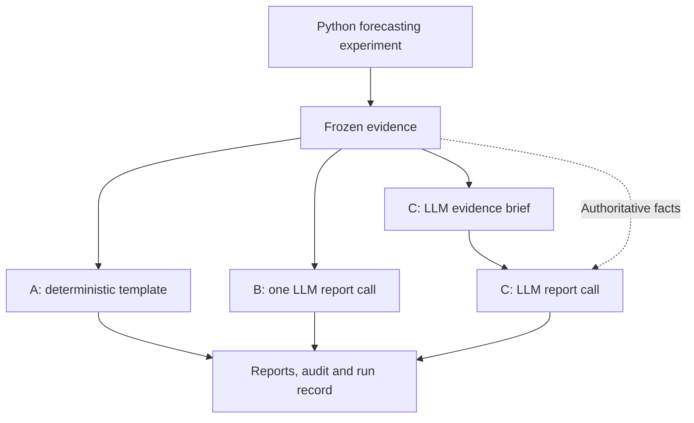

# Module 1: From a forecasting notebook to an agentic workflow

Status: revised after independent critique and the user's selection of Australian retail turnover with 12–20 series, 22 October 2026. **Built and verified on 23 October 2026** using 16 series. See the [implementation record](module-01-implementation.md), [executed notebook](../a01-forecasting-workflow.ipynb), and [post draft](../a01-post.md). Genuine B/C outputs passed the structural contract but contain documented semantic/content defects, retained as findings. The sections below record the build specification; optional repeated runs and independent human editorial review have not been performed.

Review history: [independent critique and integration decisions](module-01-critic-review.md); [initial plan](module-01-plan-initial.md).

## 1. Purpose and scope

Create one Substack post and one companion notebook introducing **prompt chaining / sequential workflow**. Start with a reproducible forecasting experiment, then compare three ways to communicate its results: a deterministic template, one LLM call, and a two-call chain.

**Central question:** does separating evidence interpretation from report writing improve a forecasting report enough to justify another model call?

The chain is a fixed LLM-assisted workflow. Its language stages explain an experiment; Python controls fitting, selection, and scoring. This deliberately limited first module establishes the tools, evidence boundaries, and evaluation habits needed for later modules on routing and adaptive tool use. The first LLM stage has a concrete output that the second consumes, but its usefulness remains an empirical question.

Define the audience as a **nontechnical retail analyst or planning manager reviewing a historical forecasting experiment across 16 state–industry series**. The reader needs to understand the mix of selected models, whether the approach beats a seasonal baseline across the panel, which series deserve closer review, and one supported limitation. This portfolio synthesis gives the language stages a more substantial task than narrating one winning model.

Prerequisites: pandas, chronological train/test splits, and basic forecasting. Learning outcomes:

- Extract numerical work from a notebook into small callable functions.
- Distinguish a conventional pipeline, a single LLM reporting step, and a sequential prompt chain.
- Pass structured evidence and intermediate outputs between stages.
- Inspect failures, factual support, and narration overhead separately from forecast accuracy.

The post must remain open to the template or single-call report being sufficient. Identical forecasting decisions imply identical forecasts across the reporting arms; improved accuracy is outside this experiment's claim.

## 2. Data and forecasting task

Use the Australian Bureau of Statistics **Retail Trade, Australia, June 2025**, Table 11, *Retail Turnover, State by Industry Subgroup, Original*: [release and source context](https://www.abs.gov.au/statistics/industry/retail-and-wholesale-trade/retail-trade-australia/jun-2025), [official XLSX](https://www.abs.gov.au/statistics/industry/retail-and-wholesale-trade/retail-trade-australia/jun-2025/8501011.xlsx). Select original monthly observations in **nominal AUD millions**, preserving seasonality. Tables 12 and 13 contain adjusted/trend series and are not the source for this experiment.

Fix **four states × four industry subgroups = 16 series**. The table below records the actual ABS series IDs verified in the workbook's `Data1` sheet. Extract by ID and assert the corresponding labels, units, frequency, and original-series status.

| State | Supermarket and grocery stores | Clothing retailing | Hardware, building and garden supplies retailing | Cafes, restaurants and catering services |
|---|---|---|---|---|
| New South Wales | A3349335T | A3349399C | A3349337W | A3349709X |
| Victoria | A3349565X | A3349483V | A3349416V | A3349640L |
| Queensland | A3349882C | A3349477X | A3349479C | A3349481R |
| Western Australia | A3349744F | A3349507A | A3349909T | A3349910A |

Use **January 2000–June 2025: 306 months per series, 4,896 observations**. The planning audit confirmed all 16 complete monthly grids, unique dates, and finite, strictly positive values. These checks establish data suitability; they do not establish model performance. Repeat them during implementation. Normalized schema: `series_id, state, industry, date, turnover_aud_millions`, with month-start dates and unique `(series_id, date)` keys.

The panel is fixed before running models. It covers four distinct industry subgroups and four states without mixing subgroup series with their parent totals. Its size permits a readable 16-row results table while creating useful variation in turnover scale and seasonal patterns. Do not replace poorly forecast series or choose a smaller subset after seeing scores. The intended comparison is additive versus multiplicative seasonality, with and without trend damping; different winners are possible, not required.

Task: forecast the next **12 months for each series**, then explain the portfolio of results. These are sector turnover forecasts, not item demand or inventory recommendations. Retain the pandemic observations as recorded. Do not smooth away shocks, introduce intervention regressors, or tune training windows in this module. Explain that regular monthly sampling does not imply an absence of structural change. The source publication ended in June 2025, so the exercise is historical rather than a continuously refreshed forecast service.

Pin the June 2025 release and save source URL, release date (31 July 2025), retrieval date, source and normalized-file checksums, selection manifest, and extraction instructions. The workbook inspected for this plan has SHA-256 `13853143285f65c1d368c51b81e9bf83aab1d9613dac1c091e0dd38e6c64ae5c`. Ship the small normalized panel and its provenance with the notebook; default execution must not download data. Keep the source workbook as an authoring input. This uses one historical-data vintage, not observations reconstructed as originally available at every forecast origin; disclose that limitation.

Adapt exponential-smoothing examples from [`m02-smoothing-methods.ipynb`](../m02-smoothing-methods.ipynb), chronological evaluation from [`m08-validation-methods.ipynb`](../m08-validation-methods.ipynb), panel presentation ideas from [`m14-tsfm.ipynb`](../m14-tsfm.ipynb), and stage separation/reporting lessons from [`m16-agents.ipynb`](../m16-agents.ipynb). Keep the irregular energy timestamp example outside this module.

Use five fixed CPU candidates, in the following tie-break order:

| Candidate ID | Specification |
|---|---|
| `seasonal_naive` | Repeat the last 12 observations |
| `hw_add` | Additive trend, additive seasonality, no damping |
| `hw_add_damped` | Additive trend, additive seasonality, damped trend |
| `hw_mul` | Additive trend, multiplicative seasonality, no damping |
| `hw_mul_damped` | Additive trend, multiplicative seasonality, damped trend |

All Holt-Winters candidates use seasonal period 12, estimated initialization, no Box–Cox transform, and no bias correction. Estimate smoothing and, where applicable, damping parameters within each training slice. Specify the optimizer and package versions during implementation and preserve convergence status. These are fixed Holt-Winters specifications; do not imply that an automatic search over all ETS error/trend/seasonal combinations is being performed.

Use existing NumPy, pandas, and statsmodels dependencies. Keep the XLSX extraction dependency in the authoring preparation step; notebook readers consume the bundled CSV. Foundation models, adaptive searches, prediction intervals, generated Python, orchestration frameworks, and deployment remain outside this module.

## 3. Chronological evaluation protocol

Development data ends in June 2024. Seal **July 2024–June 2025** for final evaluation. Apply the same dates to every series; use an expanding training window starting in January 2000.

| Fold | Training period | Training observations | Validation period |
|---|---|---:|---|
| 1 | January 2000–June 2021 | 258 per series | July 2021–June 2022 |
| 2 | January 2000–June 2022 | 270 per series | July 2022–June 2023 |
| 3 | January 2000–June 2023 | 282 per series | July 2023–June 2024 |

Select **one candidate per series** using the lowest mean of its three validation RMSEs at full precision. Resolve exact ties using the catalog order above. This is a fixed Python selection rule, not an LLM routing decision. There are 16 × 5 × 3 = **240 validation evaluations**, of which 192 fit Holt-Winters models. No global winner is forced onto all series.

Refit each selected candidate on its 294 development observations. Freeze the resulting 16 × 12 forecasts before scoring the holdout. Evaluate seasonal naive on the same 192 held-out observations for context; do not rank every candidate on the holdout and then reselect. Preserve this numerical result for all subsequent reporting experiments.

Report RMSE and MAE in AUD millions for each series. For comparisons across series, use **MASE with seasonal period 12**: divide forecast MAE by the mean absolute 12-month difference in that series' training data. Recompute the denominator from each fold's training slice; use the 294 development observations for final-test scaling. A zero or nonfinite denominator is an explicit validation failure, not a value to repair with epsilon.

The portfolio headline is the equal-weight mean of the 16 final MASE values for the delivered forecasts, alongside the same statistic for seasonal naive and a count of per-series wins/ties/losses. Determine those counts using full-precision final MAE comparisons; within a series this gives the same direction as MASE. Do not average raw RMSEs across differently sized markets as the headline. MASE below one refers to its historical scaling denominator, not proof of beating seasonal naive on the actual holdout. Use the explicit same-holdout comparison for that claim.

Show selected-model counts and all 16 rows, including failures or fallbacks. Do not describe the selected panel as all Australian retail. All three reporting arms receive the same table. The three series with the largest final MASE (ties ordered by series ID) form a fixed review list for the narrative; show their baseline comparisons even if all three outperform it. This list directs retrospective review only and cannot alter selection.

Validation and final-test comparisons are separate facts. A validation winner can lose on the holdout; the report must explain that outcome accurately. Final-test results cannot change the model choice.

Use explicit positional boundaries and date assertions. Do not reuse m02's inclusive date-slice helper unchanged, because both sides can contain the boundary. Each fold must have disjoint training and validation observations; expanding folds intentionally share history with one another. All development decisions exclude the final holdout. Fit any learned preprocessing within the applicable training slice.

Both LLM stages run **after** the frozen experiment and can therefore receive its final metrics. Label the output a retrospective experiment report. At a real future forecast issuance time, final outcomes would be unavailable; this module must not imply otherwise.

## 4. Architecture and controls

Compute the numerical experiment once:

`load → validate → split → profile → backtest → select → refit → freeze forecast → final evaluation → frozen evidence`

Use the same evidence for three reporting arms:

| Arm | Reporting path | Purpose |
|---|---|---|
| A | Evidence → deterministic template | Complete conventional reference |
| B | Evidence → one LLM report call | Simplest language-model control |
| C | Evidence → LLM evidence brief → LLM report | Sequential prompt-chain demonstration |

In C, the first call synthesizes the 16-series result table into supported portfolio findings, notes on the three preselected review series, and limitations. The second call turns that brief into an audience-appropriate report and receives the original authoritative evidence as well. The brief is an intermediate interpretation, never a replacement for the source facts. Run one B call and two C calls for the whole panel; do not create a separate agent or chain for every series.

Use the same source evidence, final-report requirements, model configuration, and final-report length limit for B and C. C has an additional call and additional inference work; measure that difference rather than implying equal computation.



The branches are experimental alternatives. Execute them separately in the notebook; this diagram does not introduce parallel agent execution. Use plain Python orchestration and bounded direct model calls.

## 5. Report contract and evidence contracts

Every arm produces the same format: a **Python-rendered portfolio headline and 16-row results table**, followed by prose covering the model mix, final evaluation, three series to review, and one limitation. Keep the combined prose to at most **300 words**. The headline contains macro-average MASE, the baseline comparison, win/tie/loss counts, and fallback count. Each row contains the series label, validation-selected model and mean validation RMSE, delivered model/status, final RMSE/MAE/MASE, and the same-holdout seasonal-naive comparison. The table supplies complete numerical coverage; the prose explains its implications within the evidence.

Keep one small, immutable evidence packet with stable IDs, for example:

- `data.source_vintage`, `data.panel_manifest`, `data.development_span`, `data.observation_count`, `data.units`.
- `protocol.validation_folds`, `protocol.final_holdout`, `protocol.season_period`, `protocol.selection_rule`, `protocol.scaling_rule`.
- `models.catalog` and `series.<abs_id>.backtest.<model>.folds`.
- `series.<abs_id>.selection`, `series.<abs_id>.delivery`, and `series.<abs_id>.evaluation`.
- `portfolio.selected_model_counts`, `portfolio.delivered_model_counts`, `portfolio.final_comparison`, `portfolio.fallback_count`.
- `portfolio.review_series` and `limitations.nominal_turnover`, `limitations.fixed_vintage`, `limitations.panel_scope`.

Include only facts actually computed or declared in the protocol. Any descriptive level comparisons use development data. Keep raw full-precision results separately from the compact LLM evidence packet. Send summaries for all 16 series and protocol metadata, not 4,896 raw observations. The numerical comparison objects contain both values and a machine-computed direction such as `lower`, `equal`, or `higher`. Keep validation selection facts separate from final evaluation facts. Aggregate fields explicitly identify whether they describe selected or delivered models.

Required LLM response shapes:

```text
EvidenceBrief = {
  findings: [Claim, ...],      # 1–3 items
  review_series: [SeriesClaim, SeriesClaim, SeriesClaim],
  limitations: [Claim, ...]    # 1–2 items
}
Claim = {
  text: string,               # at most 50 words
  evidence_ids: [string, ...] # at least one known source ID
}
SeriesClaim = {
  series_id: string,          # one of the three fixed review IDs
  claim: Claim
}

Report = {
  selection: Claim,
  evaluation: Claim,
  review_series: [SeriesClaim, SeriesClaim, SeriesClaim],
  limitation: Claim
}                             # combined claim text at most 300 words
```

Use strict JSON parsing. Validate required fields, types, item limits, word limits, and source IDs; reject unknown fields and empty references. Require the three review IDs exactly once and in the computed order, with at least one evidence reference belonging to the named series in each SeriesClaim. Do not recover a model choice by searching arbitrary text as m16's permissive parser can do. Neither response shape grants authority to change a model or metric.

The analyst prompt asks for evidence-grounded portfolio findings, review-series observations, and explicit limitations. The reporter prompt specifies the audience, required sections, the validation/test distinction, and the word limit. Avoid invented causes for state or industry differences. B receives the same reporting instruction and source evidence, without the intermediate brief. C must use the brief as an input while checking it against original facts. Render the citations in an expandable or ordinary notebook evidence table.

Schema validity establishes structural correctness. It does not establish that a sentence is supported, even when a real evidence ID is cited. Review every displayed narrative with the rubric in section 9.

## 6. Minimal implementation and execution modes

Proposed files to create during implementation:

```text
agentic_ts/
    __init__.py
    forecasting.py
    workflow.py
data/a01/
    abs_retail_panel.csv
    manifest.json
scripts/prepare_a01_data.py
a01-forecasting-workflow.ipynb
a01-post.md
tests/test_a01_workflow.py
examples/a01/recorded_run.json
graphs/atsf01-graph1.png ... atsf01-graph3.png
graphs/atsf01-table1.png ... atsf01-table9.png
```

`prepare_a01_data.py` reads the pinned source workbook and writes the selected CSV and provenance manifest. It is an authoring utility, outside the reader execution path. Document its XLSX reader dependency and exact command. `forecasting.py` contains panel validation, splitting, profiling, the five candidate specifications, backtesting, per-series selection, final forecasting, and scoring. `workflow.py` contains the template, two prompts, the one-call and chained runners, a small local-LLM adapter, response validation, replay matching, and JSON serialization. Keep plotting and teaching prose in the notebook. Plain dictionaries or dataclasses are sufficient; no generalized task engine is needed.

Core interfaces should return structured results: `load_panel`, `validate_panel`, `split_series`, `backtest_candidates`, `select_candidate`, `forecast_selected`, `evaluate_forecast`, `summarize_panel`, and `render_report(arm, evidence, mode)`. Apply the same numerical functions to each series in a deterministic loop; an ordinary loop is sufficient. Keep source data outside the language-call adapter. Run from the repository root in the existing locked environment, following the setup in [README.md](../README.md). The default replay run must not start a service or download data or model weights.

**Reader default: `RUN_MODE = "replay"`.** Recompute the numerical experiment, then replay genuine captured language responses only when the evidence matches. Make one explicit configuration switch enable live calls. Keep the model ID and local endpoint configurable. The author must document one model configuration actually tested; do not require m16's historical model choice. Verify the installed client API when implementing the adapter.

**Author requirement:** obtain a genuine successful live example for both B and C, save exact prompt text, responses, model/settings, statuses, and observed timings. Keep captured responses immutable. A and B should be saved alongside C in the compact example record for comparison. If live inference is unavailable, numerical implementation can continue, but the genuine example and publication-ready empirical discussion remain incomplete.

For replay matching, serialize the LLM evidence in stable key order, with dates standardized and finite metric values rounded to four decimal places; retain the full-precision values and computed comparison directions in the numerical record. Match the input data fingerprint, panel manifest, a versioned digest of this canonical evidence, the exact prompt templates and report contract, and the captured model/settings. For C, also verify the recorded first response used to construct the second prompt. Reject a mismatch and visibly use the template. Never attach an old narrative silently to changed evidence. A changed winner, comparison direction, fallback, or review-series ordering must always invalidate a match, even if rounded values look identical.

Store one compact JSON run record containing configuration, data fingerprint, package versions, numerical evidence, and per-stage status/duration/input IDs/output IDs. For language stages, retain observable prompts and responses and token usage when returned. Do not log credentials. Show live, replay, fallback, and injected-case status clearly. Archived live timings are historical measurements; replay timings are not inference latency.

## 7. Failure behavior

Keep one constructed failure in the teaching notebook. Inject an unknown evidence ID into an otherwise well-formed response, show rejection, and render the deterministic template. This tests a rule the declared validator can enforce. Label it as injected. The reversed free-text comparison seen in m16 can be discussed as a semantic review example; it is not automatically caught by a JSON validator.

Implementation policies, without adding more demonstration cases:

- Missing panel members, duplicate series-month keys, invalid units/frequency, irregular grids, or invalid values stop the numerical workflow with a clear error; no silent imputation, aggregation, or dropping a series.
- A candidate with a failed fit, explicit optimizer nonconvergence, or nonfinite predictions/scores is ineligible. Require all three folds; never average only its successful folds. Preserve warnings and failed status in the record.
- Candidate eligibility and selection operate per series. If a Holt-Winters specification is ineligible for one series, retain its failed status there and compare the remaining eligible candidates. If the selected model fails during final refit, deliver a labeled seasonal-naive fallback for that series and retain both selected and delivered identities. If a series' baseline also cannot execute, stop with a numerical failure; do not publish a successful portfolio report over a silently reduced panel.
- A language call gets a finite timeout and no automatic repair loop. Disable client-level automatic retries or count and bound them explicitly; the core demonstration should make one attempt per planned call.
- If C's first stage fails, skip its second stage and use the template. If B or C's reporter fails, use the template. Preserve the numerical result, failed attempt, and narration-failure status. Do not count a fallback as a successful LLM response.
- A replay mismatch also uses the visible template fallback. The recorded narrative is not treated as evidence for the current result.

## 8. Notebook and Substack narrative

Build a short notebook around the following sequence, targeting roughly 15–20 code cells rather than a cell-count requirement:

1. State the forecasting request, reporting audience, and limited autonomy of this module.
2. Load and validate the 16-series retail panel; show its state–industry layout, histories, units, and final holdout.
3. Introduce seasonal naive and the four Holt-Winters variants, with the exact validation protocol.
4. Run the numerical experiment and inspect fold metrics, per-series selection, and frozen forecasts.
5. Show the final evaluation and the immutable evidence packet.
6. Render A's useful deterministic report.
7. Run B and inspect its response and source references.
8. Run C, inspecting both the intermediate evidence brief and final report.
9. Show the three portfolio reports side by side, with the shared numerical headline and 16-row results table.
10. Inspect a compact stage trace and apply the factual-review rubric.
11. Run the injected unknown-reference case and show the fallback.
12. Compare narration overhead and limitations; introduce routing as the next module.

Core publication assets: the architecture diagram; one 4 × 4 small-multiple figure with states as rows and industries as columns; one 16-row metrics/comparison table. In the figure, show January 2019–June 2025 actuals, selected/delivered forecasts and baseline over the final holdout, and the June 2024 cutoff. Label each y-axis in AUD millions and make differing scales clear; the shorter plotting window does not change training history. **Export revision requested 23 October 2026:** save every graph and table, including development histories and supporting tables, to `graphs/` using `atsf01-graph<number>.png` and `atsf01-table<number>.png`. Number graphs and tables independently in notebook order. There are three graphs and nine tables. Use explicit filename placeholders and a full asset index in the article. Captions distinguish live captures, replayed outputs, and injected cases.

Working post title: **From a Forecasting Notebook to an Agentic Workflow: Who Does What?** Aim for approximately 2,000–2,500 words, letting results determine length.

Suggested article sequence: 16 forecasts create a portfolio review task → establish the retail panel and conventional experiment → explain the three reporting paths → inspect one real chain and its treatment of difficult series → compare evidence quality and overhead → expose a failure → explain what this fixed workflow can establish → transition to routing. Write empirical conclusions after execution. Claims about readability or time saved require a separate reader study; examples alone do not measure those benefits.

## 9. Evaluation and focused checks

The core is **one inspectable 16-series case study** of A, B, and C, with genuinely recorded language outputs and one injected failure. Sixteen forecasting series do not constitute 16 independent evaluations of reporting quality: there is one portfolio report per arm. No winner or numeric outcome is predetermined.

Review each report with this table and record the supporting text/evidence:

| Criterion | Passing condition | How checked |
|---|---|---|
| Selection | Correct per-series selections, model counts, and validation rule | Rendered facts plus prose review |
| Delivery | Correct distinction between selected and delivered model if fallback occurs | Structured facts plus prose review |
| Evaluation | Clearly distinguishes validation from final holdout | Prose review |
| Comparisons | Every stated better/worse relationship agrees with computed direction; portfolio and per-series claims stay distinct | Prose review against evidence |
| Review series | All three required series addressed with correct baseline comparisons and delivery status | IDs/order checked in code; meaning reviewed manually |
| Attribution | Factual statements are supported by their cited evidence | Valid IDs checked in code; meaning reviewed manually |
| Limitation | One specific, supported limitation without invented causal explanations | Prose review |
| Completeness | Selection, evaluation, three review-series entries, and limitation present | Schema validation |

Show failures as well as accepted reports. Count schema rejection and narration failure separately from semantic mistakes in accepted prose. A human reviewer should audit the prose independently of any model self-assessment. This small rubric measures correctness and completeness, not subjective reader preference.

Report the 16-series numerical results and portfolio metrics once, because all arms share them. State that model selection uses per-series validation RMSE, while the portfolio headline uses scale-adjusted final MAE (MASE); these are different summaries with different purposes. Record per-arm narration calls and observed latency, including failed attempts. Report token usage only where returned and available; local inference has no invented dollar price. Show common numerical runtime separately from narration overhead. The core comparison does not claim end-to-end speedups.

Optional extension: five live repetitions per LLM arm on identical frozen evidence, with raw outcomes, ranges, and failure counts. This adds a limited illustration of variation, not a general benchmark. Keep recorded outputs and call settings identifiable. If undertaking an end-to-end runtime comparison, explicitly execute and time complete paths under stated conditions instead of rebranding cached reporting timings.

Required focused checks, implemented with standard-library `unittest` unless an existing project test convention dictates otherwise:

- Exact panel membership, source IDs and units, 306 monthly observations per series, calendar/fold boundaries, no within-fold training/validation overlap, and no holdout in fitting/selection inputs.
- Seasonal-naive repetition and dated, finite, 12-step outputs.
- Per-series selection, catalog tie order, and candidate/final-refit failure handling using small controlled fixtures.
- Training-only MASE denominators, equal-weight portfolio summaries, complete panel coverage, win/tie/loss counts, and fixed review-series ordering on hand-calculable fixtures.
- Reporting arms cannot mutate frozen numerical evidence; selected model and forecast arrays remain unchanged after each arm.
- Response contract enforcement, unknown evidence rejection, skipped second call after first-stage failure, and visible fallback.
- Replay accepts matching evidence/prompts and rejects changed winners, directions, or required source facts.

Use deterministic model-response fixtures for tests; genuine recorded output belongs in the demonstration. Then execute the notebook from a fresh kernel in default replay mode, verify the live path during authoring, inspect exported assets, and cross-check article numbers against saved results. No full repository notebook rerun is required.

## 10. Implementation order and completion criteria

1. Extract the pinned ABS workbook into the bundled 16-series CSV and provenance manifest; reproduce the source audit.
2. Implement the five candidate specifications, per-series selection, chronological experiment, and portfolio scoring.
3. Freeze the result packet and produce A's complete portfolio template report and results table.
4. Define exact evidence IDs, prompts, response schemas, and the human audit sheet.
5. Implement B and C, including bounded failures and the compact run record.
6. Execute genuine live examples; audit their prose and save the matching replay record. Preserve actual failures in the authoring record and disclose any example-selection rule.
7. Assemble the notebook, verify default replay and the injected failure, and export core assets.
8. Write the Substack article from observed results; verify all references, figures, and claims.

Complete means: the deterministic 16-series experiment is reproducible from the bundled panel and pinned provenance; all three reporting paths are demonstrated over the same complete results; C has a real brief-to-report dependency; genuine captured outputs are traceable; replay matching works; failures remain visible; numerical results survive reporting unchanged; and the post explains the scope of the evidence without claiming forecasting gains or measured productivity benefits. A poor Holt-Winters result is a finding to report, not a reason to change the panel or final holdout.

If the two-call chain offers no apparent advantage, publish that result and explain what additional task complexity might motivate later architectures. The reusable outcome is the numerical toolkit and a disciplined way to compare coordination patterns.

## 11. Reference vocabulary

The terminology follows [Anthropic's workflow taxonomy](https://www.anthropic.com/research/building-effective-agents) and [LangGraph's workflow guide](https://docs.langchain.com/oss/python/langgraph/workflows-agents). These are conceptual references, not required frameworks. Adapt notebook functions deliberately: m02's split semantics and m16's permissive parsing, silent model defaults, and reporter comparison error should not be inherited unchanged.
