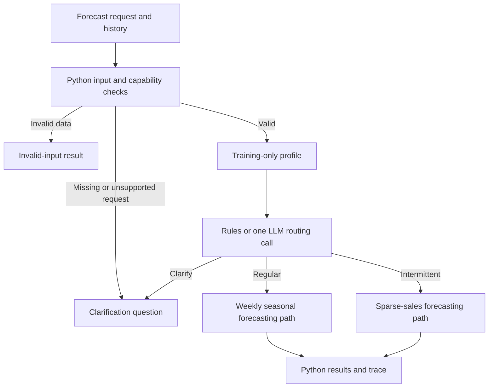

# Module 2: One forecasting request, several possible problems

Initial build plan, 24 October 2026. Written before the independent critic is launched. The revised implementation specification will be [module-02-plan.md](module-02-plan.md); review and integration decisions will be recorded in [module-02-critic-review.md](module-02-critic-review.md).

## 1. The next architectural step

Introduce **routing / conditional workflow**. Module 1 varied the explanation after Python had frozen the forecasts. Module 2 lets a bounded decision choose which numerical workflow runs. The dispatcher has a fixed menu; this is not an open-ended planning agent.

Use the same request throughout the main experiment: “Forecast the next 28 days of recorded unit sales for this item.” The series can be dense, sparse, or accompanied by an incomplete or unsupported request. The lesson is to establish what problem can be answered before starting a model fit.

Central question: **can a small evidence-based router choose an appropriate forecasting path, and does an LLM contribute anything beyond explicit rules?** A result favoring the rule-based router is publishable. Do not imply that putting a deterministic threshold into an LLM creates forecasting expertise.

The finished deliverables are a Substack draft, an executable notebook, two small Python modules, a pinned small dataset, genuine local-model captures, and a routing audit. Planning does not implement or execute these workflows.

## 2. Data: a small, heterogeneous M5 panel

Use the M5 files already present in the repository and used by [m06](../m06-sales-and-demand.ipynb): `data/sales_train_validation.csv.zip` and `data/calendar.csv`. Use store `CA_1`, retain exact item/store identifiers, and forecast observed daily unit sales. These are historical Walmart sales, not directly observed unconstrained demand. Zeros do not establish stockouts, product discontinuation, or lack of demand.

This avoids mixing ABS monthly money amounts with daily item counts and introduces the sparse series absent from A01. M5 is a larger real retail dataset; the teaching panel is deliberately small. Do not use the separate evaluation archive or later calendar outcomes to choose examples.

Before fitting, select **12 series: six dense and six sparse**. Compute zero fractions on the 365 days ending at `d_1801`, before all validation windows. Dense means zero fraction at most 0.05; sparse means zero fraction between 0.60 and 0.95, with at least 20 positive days. Sort eligible IDs lexicographically within each stratum and take the first six. These are transparent teaching strata, not claims about the optimal model family. Freeze IDs before any validation or final scores.

A read-only planning audit found 3,049 CA_1 series, 63 dense candidates and 1,438 sparse candidates under those predicates. First six dense IDs: `FOODS_1_018_CA_1_validation`, `FOODS_1_046_CA_1_validation`, `FOODS_1_085_CA_1_validation`, `FOODS_1_099_CA_1_validation`, `FOODS_1_110_CA_1_validation`, `FOODS_1_161_CA_1_validation`. First six sparse IDs: `FOODS_1_001_CA_1_validation`, `FOODS_1_002_CA_1_validation`, `FOODS_1_008_CA_1_validation`, `FOODS_1_009_CA_1_validation`, `FOODS_1_010_CA_1_validation`, `FOODS_1_011_CA_1_validation`. Repeat calendar and value validation during extraction; do not treat this audit as model evidence.

Bundle only the selected histories needed for fixed 365-day training windows, three 28-day validation folds, and a 28-day holdout: `d_1437` through `d_1913`, 477 days per series, 5,724 rows. Normalize to `series_id, date, sales_units`. Retain raw IDs and item/category/store metadata in the manifest. Save the selection algorithm, source paths/URLs, extraction date, source/normalized checksums, and label definitions. Record the dataset's usage/redistribution terms during preparation.

Local source SHA-256 values verified during planning:

- Sales ZIP: `88cf53dbb3782b93dc64c038f7589a2677ff171df8857346a07745fb80f9803e`.
- Calendar CSV: `d12b5914ef03e66649adf5dd9e996e6602251c22b7a6af8f1f7e3aa12f8860f5`.

Readers use the bundled subset without downloads. Do not melt the full M5 panel in the teaching notebook as m06 does.

## 3. Request, profile, and decision contracts

Keep a small normalized request: `request_id, series_id, text, target, horizon, frequency, units, as_of`. The core target is `observed_sales`, horizon 28, frequency daily, units item units. This module assumes the structured fields are supplied; unrestricted natural-language request parsing is deferred.

Python validates duplicate dates, the daily grid, finite nonnegative values, minimum 365 observations, required request fields, and consistency between requested and available units/frequency. Missing values are not zeros. Invalid data returns `invalid_input` without fitting or calling the LLM. Missing horizon or an unsupported target such as unconstrained demand without availability evidence returns `clarify` with one concrete question. These are explicit prechecks, not LLM successes.

For a valid request, Python creates immutable training-only evidence with stable IDs: observation count/span, zero fraction, positive-day count, mean positive sale size, lag-7 autocorrelation, units/frequency, target, horizon, and known availability limitations. Do not round numerical routing evidence before decisions. Raw histories, validation losses, and held-out outcomes are not sent to the router.

One LLM response contains exactly `route, evidence_ids, reason, clarification_question`. Route is `regular`, `intermittent`, or `clarify`; reason is at most 60 words and must cite existing evidence. A clarification requires a nonempty question and produces no forecast. No confidence score is used as an automatic decision threshold. Schema validity and supported reasoning are separate checks.

The LLM can choose a family, not a model name, hyperparameter, preprocessing change, aggregation, or new tool. A schema-valid alternative family must actually run; do not silently replace it with the rule's family merely because they disagree.

## 4. Three terminal outcomes and bounded specialists

| Route | Concrete action | Fixed numerical procedure |
|---|---|---|
| `regular` | Fit a regular weekly forecasting path | Validate seasonal naive (period 7) and additive seasonal Holt–Winters with damped additive trend; select mean validation RMSE winner |
| `intermittent` | Fit a sparse-sales forecasting path | Validate seasonal naive (period 7) and TSB with fixed demand/probability smoothing 0.1/0.1; select mean validation RMSE winner |
| `clarify` | Return one specific question | No numerical fitting or invented answer; resume after an explicit corrected request only as an optional extension |

Use statsmodels for the familiar Holt–Winters specification and the installed StatsForecast TSB implementation. Do not copy m06's Croston implementations or metric epsilon handling without auditing their edge cases. Forecasts are expected sales rates: fractional outputs are permitted. Apply a declared nonnegative clamp to all candidates before validation scoring and record any affected forecasts. A failed model is ineligible; the shared seasonal-naive baseline is the numerical fallback. Baseline failure stops that request visibly.

Branch selection precedes candidate selection. Python chooses a model within the selected family using past validation windows. An LLM has no access to final errors and cannot override the numerical winner.

There is one dispatch to one specialist per request. No parallel crew, iterative tool loop, LLM reporting chain, data repair agent, anomaly investigation, hierarchical pooling, inventory optimizer, or production deployment.

## 5. Controls: separate architecture from model quality

Run all controls on the same 12 valid requests with the same numerical implementation and data boundaries:

| Control | Family choice | Purpose |
|---|---|---|
| A: fixed path | Always `regular` after shared prechecks | Conventional one-workflow reference |
| B: rule-based router | If training zero fraction is at least 0.50 choose `intermittent`; otherwise `regular` | Transparent, inexpensive routing control |
| C: LLM router | One bounded call with the request, evidence, and documented routing guidance | Tests model-mediated dispatch |

The 0.50 threshold is an author-declared teaching policy, not a universal intermittency boundary. Give C that policy; compare its agreement with B without claiming that B's labels are statistical truth. Both see the same inputs. The rules have perfect agreement with their own policy by construction; that score is a compliance check, not a discovered advantage.

Also compute an offline **all-candidate validation selector** across seasonal naive, Holt–Winters, and TSB. It is a useful numerical reference for the cost of restricting a family; it is not an extra agent or a holdout oracle. Do not define the “correct route” as whichever branch happened to win on the holdout.

For inspection, include four explicitly authored request/data variants: missing horizon; latent-demand target without availability evidence; one missing date; and conflicting requested units. They reuse existing histories, are not four additional real datasets, and must not inflate the 12-series forecast denominator. Prechecks should stop each with the right status and no specialist execution.

## 6. Temporal protocol and metrics

Use fixed 365-day training windows at each origin. All cutoffs apply to all selected series:

| Role | Last training day | Evaluation days | Calendar evaluation span |
|---|---|---|---|
| Validation 1 | `d_1801` | `d_1802`–`d_1829` | 4–31 January 2016 |
| Validation 2 | `d_1829` | `d_1830`–`d_1857` | 1–28 February 2016 |
| Validation 3 | `d_1857` | `d_1858`–`d_1885` | 29 February–27 March 2016 |
| Final holdout | `d_1885` | `d_1886`–`d_1913` | 28 March–24 April 2016 |

Select the panel at the first origin, then preserve it. At final issuance, build the router's profile from the 365 observations ending `d_1885`; later training data can legitimately change the route. Freeze all final family/model choices and 28-step forecasts before opening holdout values for scoring. Fit each validation candidate on its corresponding training window and require all three folds to succeed. Resolve ties in a fixed order with seasonal naive first. Do not reselect or alter thresholds after seeing final scores.

Report route-policy agreement, clarification/invalid-input handling, schema failures, supported/unsupported reasons, and branch execution counts separately from forecasting errors. Show per-series RMSE and MAE, plus weekly MASE (lag-7 training-only denominator) for scale-adjusted summaries; an undefined denominator is explicit, not repaired with epsilon. This is not an official M5 leaderboard score.

Show A/B/C and the all-candidate reference on every valid series, grouped by initial dense/sparse stratum. Report errors against the shared seasonal-naive reference and losses as well as wins. Family disagreement can still give better forecasts; policy compliance and realized accuracy answer different questions.

An invalid LLM response, timeout, or replay mismatch invokes B once and records `routing_fallback`; do not count that as successful C routing. A valid C clarification on a supported core case is an abstention, with no forecast. Report coverage over all 12 requests and any conditional error denominator explicitly. Do not claim an accuracy win from omitting harder requests.

Numerical counterfactuals may be cached for analysis, but cached lookups are not evidence of an end-to-end speedup. Record actual LLM attempts/tokens/latency and logical candidate-fit counts; compare uncached end-to-end time only if actually executed that way. Keep model loading separate where the backend returns it.

## 7. Live capture, replay, and failure inspection

Default the notebook to `CFG.run_mode = "replay"`. Reuse A01's local Ollama approach and immutable evidence concept, not its ABS-specific loader, month-12 assumptions, or report-specific capture contract. Use the installed local model from `CFG.llm`; start with the same Qwen configuration and record the actual server/model digest and generation settings during authoring. No model upgrades or downloads are necessary for this module.

Capture one genuine C routing attempt for each of the 12 valid requests in stable request-ID order. Preserve failures and clarification decisions. Keep the two illustrative route walkthroughs predetermined as the first dense and first sparse ID, even if the LLM gets them wrong. Do not retry until it agrees with B. Client retries must be disabled; use one finite-timeout request per eligible case and no repair loop.

Replay requires exact request/profile/policy/contract/prompt/settings matches, including unrounded threshold-relevant values. Mismatches visibly use B. Preserve original response text, parsed proposal, accepted dispatch, fallback reason, downstream method, and numerical forecast separately. Render output summaries in Python rather than adding an LLM reporter from A01.

Add one injected out-of-menu response, clearly distinct from the real capture: request an unknown specialist and show schema rejection before any dispatch. Show a genuine schema-valid wrong route if one occurs; otherwise discuss that possibility without fabricating a live result.

## 8. Notebook, article, and visual assets

Use matching titles from the outset:

| Notebook and post title | Main content |
|---|---|
| Setup; Utils | Notebook-only imports/settings in CFG, helper functions |
| One request, different series | Introduce the common request and heterogeneous panel |
| Define the routing contract | Evidence, allowed choices, prechecks, and clarification |
| Build the forecasting paths | Two small numerical specialists and common baseline |
| Compare fixed, rule-based, and LLM routing | A/B/C controls and the all-candidate numerical reference |
| Follow a request through the workflow | One dense, one sparse trace; no handpicked success |
| Evaluate decisions and forecasts separately | Routing audit, final errors, coverage, and limitations |
| Inspect failures and overhead | Constructed input variants, out-of-menu response, timing |
| Where routing earns its place | Observed result and transition to later adaptive tool use |

The notebook targets roughly 20 code cells; the article roughly 2,000–2,500 words. Keep imports/settings in Setup, boilerplate in Utils, and branch execution readable. Do not rerun m06 or copy its full preprocessing/training lesson.

Export every graph/table using `graphs/atsf02-graph<number>.png` and `graphs/atsf02-table<number>.png`, numbered independently. Use the existing `seaborn-v0_8` style and CFG dimensions, two decimals in displayed numeric results, no table titles or footer text, and substantive descriptions in draft captions. Keep the workflow diagram's title and explanation in its caption. All placeholders name exact files; the post includes a complete asset index.

Minimum article assets: a panel of dense/sparse histories; a routing diagram; two representative forecast panels; a full request/route/dispatch audit table; a per-series forecast comparison; a compact coverage/failure/overhead table. Export other displayed tables as well, without making every one a main article figure.

## 9. Implementation sequence and verification

1. Prepare `data/a02/m5_routing_panel.csv`, a provenance/selection manifest, and a small request fixture file from the local M5 archives. Freeze selection and temporal boundaries before fitting.
2. Add `agentic_ts/routing_forecasting.py` for the daily loader, profiles, fixed candidates, chronological selection, and metrics. Keep A01's monthly API unchanged.
3. Add `agentic_ts/routing.py` for request/decision contracts, shared prechecks, A/B/C dispatch, and capture/replay matching. Reuse generic A01 helpers only where their contracts fit; do not refactor A01 into a framework.
4. Establish A/B and the offline all-candidate reference, then write the router prompt and independently audit the prescribed case labels without inspecting holdout outcomes.
5. Make and preserve the genuine C captures. Audit the decision and cited reasons against the profile before final scoring; preserve disagreements.
6. Build `a02-routing.ipynb`, `a02-post.md`, capture/execute helpers under `scripts/`, and `examples/a02/recorded_run.json` plus `routing_audit.md`.
7. Run the focused checks, execute the notebook from a fresh kernel in replay, inspect all exported images, verify post claims/links, and add a short implementation record and README entry.

Focused checks: exact extraction and dates; prefix-only profiles; within-fold chronology; threshold equality; seasonal-naive and TSB edge behavior; dated finite 28-step forecasts; failed-candidate eligibility; training-only scaling; contract rejection; unsupported-input stops; exactly one allowed specialist dispatch; LLM disagreement is not overwritten; explicit fallback/abstention; replay invalidation when a value crosses the routing boundary; and immutable source evidence. Test mechanisms with controlled fixtures rather than asserting the LLM will choose a particular real-world route. Run the existing A01 tests only if shared utilities change.

Done means all three controls and the numerical reference run on the fixed panel; one route really controls the invoked specialist; genuine C failures survive into the audit; denied/clarified requests never fit; the replayed notebook runs offline; and the post can explain the observed tradeoff without claiming universal model suitability, routing accuracy, productivity, or speed gains.

## 10. References and planning evidence

- [Anthropic: Building effective agents](https://www.anthropic.com/research/building-effective-agents), routing and workflow/agent terminology. This is a taxonomy reference, not a required framework.
- [StatsForecast model reference](https://nixtlaverse.nixtla.io/statsforecast/src/core/models.html#tsb), for the TSB specialist and its demand/probability smoothing parameters. Confirm the installed version's callable interface during implementation.
- [M5 organizers' data/methods repository](https://github.com/Mcompetitions/M5-methods), for source context and provenance verification.
- Local references: [m06](../m06-sales-and-demand.ipynb), [m08](../m08-validation-methods.ipynb), [m16](../m16-agents.ipynb), and [A01 implementation record](module-01-implementation.md).

Planning verified local archive names, headers, store counts, eligibility counts, source fingerprints, and calendar cutoffs. No forecasters, router calls, new dataset extraction, or module-2 implementation were executed. All quantitative performance and overhead claims await the build.
