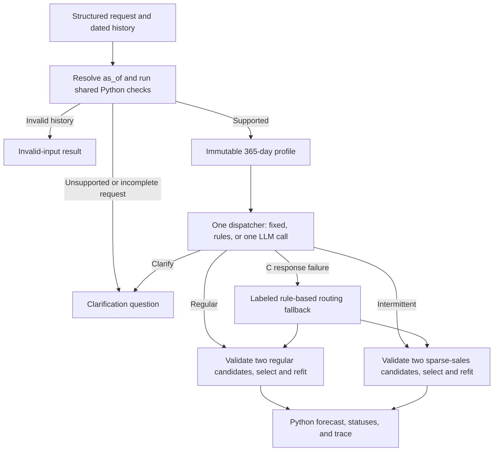

# Module 2: One forecasting request, several possible problems

Revised build plan, 24 October 2026, following an independent AI critique. **Planning only; Module 2 has not been implemented.** Read the [initial plan](module-02-plan-initial.md) and [critique with integration decisions](module-02-critic-review.md) for the review history.

## 1. Purpose: route a request before fitting

Teach **routing / conditional workflow** through one daily retail forecasting interface. In [Module 1](module-01-implementation.md), Python followed one numerical experiment and the language stages explained its frozen results. Here a routing decision changes which numerical path is invoked. Available paths remain predefined; this is a bounded workflow, not an open-ended tool-using agent.

The recurring request is: **“Forecast the next 28 days of recorded unit sales for this item.”** Different histories lead to a regular-sales candidate workflow or a sparse-sales candidate workflow. An incomplete or unsupported request leads to a clarification question before fitting.

The core comparison asks three separate questions:

1. Does each implementation follow the declared routing policy and dispatch exactly one permitted path?
2. What numerical consequences does that policy have relative to a fixed path and validating all available candidates?
3. What failures, abstentions, and inference overhead does an LLM router introduce?

The LLM is deliberately given an explicit policy and a small computed profile. This tests policy execution and dispatch, not the discovery of optimal forecasting methods. Rules may be sufficient, and a numerical selector over three cheap candidates may be preferable. A lucky policy violation on the holdout is not evidence of better diagnosis. Do not expand the module with natural-language parsing, anomaly investigation, or another reporting chain to manufacture an LLM advantage.

Deliver one Substack draft and companion notebook, a small local dataset, bounded numerical/routing functions, genuine model captures, and a decision audit. Keep empirical conclusions open until execution.

## 2. Dataset: twelve real daily histories, including boundary cases

Use the M5 files already present and used in [m06](../m06-sales-and-demand.ipynb): `data/sales_train_validation.csv.zip` and `data/calendar.csv`. Restrict to store `CA_1`. The target is **observed daily unit sales**, not unconstrained demand. Zero sales alone cannot establish stockouts, obsolescence, or zero demand. No availability or price data is supplied.

Use one daily dataset so horizons, units, and numerical comparisons stay consistent. Keep the A01 ABS panel and its monthly contracts unchanged. Do not use the separate `sales_train_evaluation.csv.zip` archive. The calendar is used to map day keys to dates, not to add future covariates.

Select **12 series before modeling: four dense, four sparse, four boundary histories**. All selection statistics use only the 365 observations ending at `d_1801`, before the first validation period. Sort IDs lexicographically within each group:

| Teaching stratum | Selection predicate | Take |
|---|---|---:|
| Dense | Zero fraction ≤ 0.05 | First 4 |
| Sparse | 0.60 ≤ zero fraction ≤ 0.95; at least 20 positive days | First 4 |
| Boundary, below half | 0.40 ≤ zero fraction < 0.50 | First 2 |
| Boundary, at or above half | 0.50 ≤ zero fraction ≤ 0.60 | First 2 |

Balancing the boundary examples across the cutoff modifies the critic's simpler “first four boundary IDs” suggestion without enlarging the panel. Initial sampling strata and the eventual final-origin route are distinct fields: a later rolling window can change the zero fraction. Density is not a test for weekly seasonality. Do not filter for a seasonality statistic or a winning method.

The read-only planning audit found 3,049 CA_1 source series: 63 dense candidates, 1,438 sparse candidates, 371 boundary candidates below half and 392 at/above half. The resulting IDs, to reproduce and pin during preparation, are:

| Stratum | IDs, each ending `_CA_1_validation` |
|---|---|
| Dense | `FOODS_1_018`, `FOODS_1_046`, `FOODS_1_085`, `FOODS_1_099` |
| Sparse | `FOODS_1_001`, `FOODS_1_002`, `FOODS_1_008`, `FOODS_1_009` |
| Boundary below half | `FOODS_1_005`, `FOODS_1_014` |
| Boundary at/above half | `FOODS_1_003`, `FOODS_1_017` |

This selection happens to yield twelve FOODS items from one store. It is a controlled teaching panel, not representative M5 coverage or a population benchmark. Keep losses, route changes, and failures; do not substitute series after scoring.

Bundle `d_1437`–`d_1913`, **4 January 2015–24 April 2016**, as `data/a02/m5_routing_panel.csv`: 477 days × 12 series = 5,724 rows. Schema: `series_id, date, sales_units`. Keep exact source IDs and item/category/store metadata in a manifest. Save the extraction command, selection predicates and origin, source URLs/paths, extraction date, usage terms, source fingerprints, and normalized checksum. Preserve legitimate zeros; missing dates/values are not zeros. Extract selected rows directly rather than melting the entire archive.

Verified local source SHA-256 values:

- Sales ZIP: `88cf53dbb3782b93dc64c038f7589a2677ff171df8857346a07745fb80f9803e`.
- Calendar CSV: `d12b5914ef03e66649adf5dd9e996e6602251c22b7a6af8f1f7e3aa12f8860f5`.

Readers use the bundled subset offline. Source fingerprints and metadata are planning evidence; forecast suitability and performance remain unmeasured.

## 3. Request contract and shared gate

Normalize requests as `request_id, series_id, text, target, horizon, frequency, units, as_of`. Core values are `observed_sales`, 28, daily, item units, and 27 March 2016. Generate the core sentence from the structured fields so text cannot contradict them. This is a structured forecasting interface; unrestricted intent extraction is deferred.

Apply checks in this order:

1. Resolve a valid `as_of`; ask for it if absent or unusable. Resolve the declared series and slice its history **at or before that date**. Never profile or validate sales values from later rows.
2. Validate that dated prefix: unique daily keys, complete calendar, finite nonnegative values. Invalid data returns `invalid_input`. There is no automatic repair, aggregation, or imputation.
3. Check request capabilities: target/horizon/units/frequency must be supplied and supported. The required model-validation protocol needs **449 consecutive available days**, although the current router profile and each model fit use 365. Insufficient history or an unsupported/missing request detail returns `clarify` with one precise question.
4. Only a complete supported request reaches a router. An answer to a clarification creates a new versioned request; it is not an automatic retry in this notebook.

The 449-day requirement is 365 training days plus three past 28-day validation periods. It corrects the initial plan's insufficient 365-observation gate. Core requests have exactly that available prefix; the additional 28 holdout days stay outside the request execution interface.

| Situation | Status | LLM calls | Forecasting paths |
|---|---|---:|---:|
| Invalid dated prefix | `invalid_input` | 0 | 0 |
| Missing/unsupported request, or insufficient history | `clarify` with a specific question | 0 | 0 |
| Supported core request under A/B | Forecast path chosen by fixed/rule policy | 0 | 1 |
| Supported core request under C | One routing attempt, followed by one accepted/fallback path or abstention | At most 1 | At most 1 |
| Valid C clarification on a supported core request | `abstained`; retain its question | 1 | 0 |

`invalid_input` is a gate status, not a fourth specialist. The four compact authored variants are missing horizon, latent-demand target without availability evidence, one missing date, and unsupported requested money units. They reuse existing histories and are labeled constructed examples; count them separately from the 12 real forecast cases. They demonstrate Python prechecks, not LLM recognition of bad requests.

## 4. Training-only evidence and a bounded routing decision

Python freezes a small routing packet with stable evidence IDs: request fields; available/current-window spans; current-window observation count, zero count and positive count; derived zero fraction; and the observed-sales/no-availability limitation. The current profile uses only the last 365 days available at `as_of`. Do not give the LLM the sampling stratum, full observation arrays, validation scores, candidate winners, or holdout values. Omit mean positive size and autocorrelation from the required packet because the policy does not use them.

The explicit family policy is **intermittent if `2 × zero_count >= observed_count`, regular otherwise**. Integer counts avoid rounded-threshold ambiguity. The 50% cutoff is an author-declared teaching policy, not a published optimal intermittency threshold or a diagnosis of demand causes. Display percentages to two decimals; route and fingerprint on unrounded counts and evidence.

The LLM response has exactly four fields: `route, evidence_ids, reason, clarification_question`:

- `route`: `regular`, `intermittent`, or `clarify`.
- `evidence_ids`: nonempty, unique, known IDs supporting the decision.
- `reason`: at most 60 words.
- `clarification_question`: nonempty for `clarify`; null for a forecasting route.

Reject unknown keys, invalid types/routes, absent references, or invalid conditional fields before dispatch. Audit unsupported seasonality, stockout, discontinuation, or latent-demand claims separately: valid JSON and citations do not prove semantic support.

A schema-valid alternative family **really runs**. A disagreement with the declared policy is recorded, not silently corrected. The model cannot name another tool/model, alter the horizon, tune parameters, repair data, or change units. A valid `clarify` is an abstention on these complete core requests; it cannot silently become a forecast.

## 5. Two numerical workflows and three dispatch implementations

| Path | Candidate set, both evaluated in Python |
|---|---|
| `regular` | Seasonal naive with period 7; Holt–Winters with additive seasonality, damped additive trend, period 7 |
| `intermittent` | The same seasonal naive; TSB with fixed demand/probability smoothing 0.1/0.1 |

Select the lowest mean three-fold validation RMSE **within the dispatched candidate set**, at full precision. The common baseline wins exact ties. Fix estimated initialization, no Box–Cox/bias correction, optimizer/convergence rules, and the nonnegative output clamp in the numerical configuration before fitting. Apply the clamp identically before scoring in every control and record affected outputs. Forecasts are expected unit-sales rates and may be fractional.

Use statsmodels for the familiar additive Holt–Winters specification and the installed StatsForecast TSB implementation. Audit interfaces and edge cases; do not copy m06's illustrative Croston code or replace undefined scaling denominators with epsilon. Require a candidate to finish all three folds. A failed nonbaseline is ineligible. A selected model's final-fit failure delivers a labeled seasonal-naive fallback, retaining selected and delivered identities. Baseline failure is an explicit numerical failure for that request, not an omitted row.

| Implementation | Family decision | What it tests |
|---|---|---|
| A: fixed forecasting path | Always `regular` after the shared gate | One conventional workflow for every supported series |
| B: rule-based router | Integer-count policy above | Transparent conditional dispatch without inference |
| C: LLM router | One call given the same evidence and explicit policy | Policy compliance, dispatch behavior, and added failure/overhead |

B agrees with its own policy by construction; that is a reference implementation check. Do not label this “100% diagnosis accuracy.” Likewise, agreement by C is policy compliance, not evidence that the policy chooses the optimal family.



A/B/C are alternatives, executed separately. A single request invokes one allowed forecasting path. No multi-agent crew, iterative repair, LLM writer, hierarchy, forecasting foundation model, inventory optimization, or deployment is required.

## 6. Temporal protocol: final-origin routing, earlier candidate validation

**Route once per series at the final origin.** The three earlier folds validate fixed numerical candidates; they are not a three-origin router backtest. C receives no fold losses and is not called at those earlier origins. All twelve C attempts use the current 365-day window ending 27 March 2016.

| Role | 365-day training slice | Evaluation days | Calendar evaluation span |
|---|---|---|---|
| Validation 1 | `d_1437`–`d_1801` | `d_1802`–`d_1829` | 4–31 January 2016 |
| Validation 2 | `d_1465`–`d_1829` | `d_1830`–`d_1857` | 1–28 February 2016 |
| Validation 3 | `d_1493`–`d_1857` | `d_1858`–`d_1885` | 29 February–27 March 2016 |
| Final fit/profile | `d_1521`–`d_1885` | `d_1886`–`d_1913` | 28 March–24 April 2016 |

After the gate/profile, freeze the family decision, run its past candidate-validation folds, select and refit using the final 365 observations, then freeze its 28 dated forecasts. All final A/B/C decisions and forecasts are sealed before final scoring. Past folds may share observations by design; training and evaluation within a fold must not overlap. No thresholds, prompts, examples, model settings, or series IDs are changed after final scoring.

Execute actual selected-path calls in the main comparison; an executor that only reads precomputed full-catalog forecasts does not demonstrate conditional fitting. At minimum, the two predetermined walkthroughs must be uncached and show which candidate functions ran and which did not. Trace every fit attempt, failure, refit, and baseline fallback separately from model requests. There is no core end-to-end speed claim.

For an **offline numerical diagnostic**, select by the same validation rule across the union of three candidates. Reuse existing fold records and compute missing counterfactuals in a separate analysis step after the main requests, without exposing them to the router. Freeze this reference's forecasts before holdout scoring too. Show its selected model/error in a comparison-table column, not as a fourth agent architecture or a holdout oracle. This directly addresses “why not validate all three?” while keeping the lesson short.

## 7. Evaluation: decisions, coverage, and errors are different outcomes

Keep one machine-readable row per original request with `proposed_route, accepted_route, dispatched_route, decision_source, dispatch_status, fallback_reason, forecast_status`, plus selected/delivered model identity. A rejected C proposal has no accepted C route; a rule fallback has its own dispatched route and source. Clarifications and numerical failures retain rows with no invented forecast error.

Publish the following counts with denominators:

- Accepted C forecasting decisions / 12; policy-consistent C forecasting decisions / 12; and policy agreement among accepted C forecasting decisions.
- C abstentions / 12, C response failures / 12, and rule-routing fallbacks / 12.
- Delivered C-system forecasts / 12, identifying how many came from the rules. Track numerical model fallbacks separately from routing fallbacks.
- Shared-gate outcomes for the four constructed cases, outside the 12-series denominator.

Report per-series final RMSE and MAE in item units, plus weekly MASE using each fold/final training window's lag-7 absolute-difference denominator. Undefined denominators remain explicit; they are never replaced with epsilon or silently dropped from a macro summary. MASE below one alone does not establish a win over the actual seasonal-naive holdout. This is not the official hierarchical, weighted M5 competition score.

Show A/B/C-system and the all-candidate diagnostic on every series, with initial stratum and final route separate. Count losses and failures. Report the C-system results with fallback sources visible, and inspect accepted-C cases separately. If C abstains, compare methods' errors on an explicitly named common delivered subset and publish its size; do not rank different-coverage averages as though they covered the same requests. A successful rule fallback does not become an LLM success. A valid but policy-inconsistent C route can forecast better or worse; neither result changes its policy-compliance label.

Record actual routing attempts, tokens, archived inference time, current replay time, and model-load time when available. Report numerical fit work separately. Cached offline counterfactuals do not measure routing savings. Keep timing descriptive and avoid productivity or speedup claims without a separately executed fair timing experiment.

## 8. Capture, replay, and a small failure demonstration

Use `CFG.run_mode = "replay"` by default. Reuse existing `FrozenJSON`, hashing, strict JSON parsing, `ModelConfig`, and `OllamaClient.complete(messages, schema)` where their contracts fit, without editing A01. Its ABS loader, month-12 metrics, report prompts, `render_report`, and replay key are not reusable routing contracts.

During authoring, preserve **one genuine C attempt per valid core request**, in stable request-ID order. Use the local model already configured for A01 initially; record the actual model/server versions, digest, settings, raw response, prompts/schema, parsed proposal, validation, accepted decision, fallback, and dispatch. Disable retries, use a finite timeout, and never retry until a favored answer appears. Capture failures and abstentions too. Do not overwrite the original capture file.

Replay recomputes the profile and numerical experiment, matching exact request, count evidence, policy, schema, prompt, model configuration, and response integrity. Include numerical configuration/protocol and the nonnegative output policy in the run fingerprint. Changed inputs invalidate the saved decision; no stale routing can be attached silently to a different history. A mismatch or C schema/transport failure makes one labeled B fallback; it is not counted as accepted C. A schema-valid C abstention remains a no-forecast result.

Use predetermined dense/sparse walkthroughs: the first ID from each group, even if C is wrong. Show one shared-gate clarification case in the article. Keep the other gate variants compact in the notebook/tests. Include one clearly labeled injected out-of-menu response to demonstrate rejection before dispatch. If a genuine schema-valid wrong route occurs, retain and inspect it; if none occurs, do not fabricate a successful live failure example. Audit reasons against their cited facts independently of the model's self-assessment.

## 9. Notebook and article structure

Use matching section titles from the start; Setup/Utils are notebook-only. The following sequence is the implementation outline:

| Shared title | Notebook work and article explanation |
|---|---|
| One request, different series | Load the pinned 12-series panel; show dense, sparse, and boundary histories |
| Define the routing contract | Structured request, as_of gate, minimal profile, enum, and clarification |
| Build the forecasting paths | Two candidate sets, shared baseline, numerical selection/failure rules |
| Compare fixed, rule-based, and LLM routing | A/B/C implementations over identical requests and evidence |
| Follow a request through the workflow | Predetermined dense/sparse dispatch traces and one gate question |
| Evaluate decisions and forecasts separately | Complete audit, coverage, final errors, and all-candidate diagnostic column |
| Inspect failures and overhead | One out-of-menu injection, actual failure/fallback statuses, descriptive timing |
| What routing adds and costs | Conclusions from observed results and boundary to later adaptive tool use |

Imports and all notebook settings live under Setup in `CFG`; helper/boilerplate functions live under Utils. Aim for a readable notebook around 20 code cells and a roughly 2,000–2,500-word post; neither count is an acceptance gate. The shared gate/enum/dispatcher should be visible enough that the conditional workflow is understandable without opening a framework.

Core article visuals are a 12-series history panel, routing diagram, and two representative forecast panels; core tables are a routing/status audit, per-series forecast comparison, and coverage/overhead summary. Export additional displayed metadata/protocol tables, but keep minor supporting outputs out of the article's main narrative. Write empirical claims after execution.

### Required figure and table exports

Save **every graph and rendered table generated by the notebook**, including every visual used in the post, as a PNG in the repository's `graphs/` folder. The exported images are deliverables of a complete notebook run.

- Graphs: `graphs/atsf02-graph<number of graph in notebook>.png`.
- Tables: `graphs/atsf02-table<number of table in notebook>.png`.
- Number graphs and tables independently, starting at 1 in notebook order, with no gaps or reused numbers. The post can display a subset in a different narrative order, but must retain the notebook's asset numbers.
- Keep the saving/rendering helpers in Utils and export paths, dimensions, resolution, seed, and display precision in CFG. Track an export registry containing kind, number, filename, and description; use it to produce the post's complete asset index.

For graphs, use the plotting style and reproducibility setup from the existing notebooks. Apply it once in Setup:

```python
# display style and reproducibility
plt.style.use("seaborn-v0_8")
plt.rcParams["figure.figsize"] = (CFG.img_dim1, CFG.img_dim2)
np.random.seed(CFG.SEED)
```

Use the existing defaults `CFG.img_dim1 = 20`, `CFG.img_dim2 = 10`, and `CFG.SEED = 42`. Preserve this style across all plots; any size adjustment for a particular layout must remain explicit. Put the workflow diagram's title and explanation in the post caption.

For **all table images**:

- Show only column headers and table data: **no table title, subtitle, footer, footnote, or other text at the bottom** of the image. Put any necessary explanation, units not already in column headers, or source note in the post caption.
- Format decimal results to **exactly two decimal places**, including numerical results embedded in prose cells. Retain identifiers, dates, and integer counts appropriately.
- Apply the same two-decimal display formatting to notebook tables. Preserve full precision in calculations, comparisons, source records, and captured model responses; presentation rounding must not affect routing or selection.
- Inspect the exported PNGs for readable text, complete rows/columns, and no clipping or leftover title/footer space.

### Required post placeholders and captions

In `a02-post.md`, each placeholder must identify the **exact graph or table number and PNG path**, followed by an image reference and a descriptive caption. Do not leave generic “insert graph/table here” placeholders. Resolve numbers from the notebook's export registry so that a caption cannot accidentally reference another asset.

For example, using the actual notebook numbers when implemented:

```markdown
<!-- Graph 1 placeholder: graphs/atsf02-graph1.png -->


*Graph 1 — `graphs/atsf02-graph1.png`. Explain what this graph shows.*

<!-- Table 1 placeholder: graphs/atsf02-table1.png -->


*Table 1 — `graphs/atsf02-table1.png`. Explain how to read this table.*
```

Keep a complete asset index in the post, including exported supporting visuals not embedded in its main narrative. After any notebook rearrangement, reconcile export order, filenames, placeholders, captions, and index entries together. Verify that every referenced file exists and that each caption describes the image it actually embeds.

## 10. Implementation sequence and completion criteria

1. **Pin inputs.** Prepare the selected CSV, provenance/selection manifest, and versioned core/constructed requests. Reproduce counts, IDs, exact daily slices and nonnegative values; freeze before fitting.
2. **Build numerical paths.** Add `agentic_ts/routing_forecasting.py` with `load_routing_panel`, `profile_history`, candidate fitting, fold evaluation, within-family selection/refit, and numerical results. Use explicit protocol arguments rather than changing A01's fixed monthly constants.
3. **Build gate and dispatcher.** Add `agentic_ts/routing.py` with request/decision validation, shared prechecks, `choose_route`, and `run_request`/one-path dispatch. Reuse the generic local client and JSON helpers. No new network client, orchestration framework, or broad forecasting registry.
4. **Establish controls and capture.** Verify A/B dispatch first; freeze C's policy/prompt/contract; make all twelve first attempts and preserve their decisions before final scoring. Derive the offline all-candidate reference separately.
5. **Assemble outputs.** Build `a02-routing.ipynb`, `a02-post.md`, a small preparation/capture/execution entry point under `scripts/`, and `examples/a02/recorded_run.json` plus `routing_audit.md`. Keep one canonical capture path and no automatic overwrite.
6. **Verify and publish-ready draft.** Run focused checks, execute the notebook from a fresh kernel in replay, verify the live path during authoring, and confirm that every generated graph/table has its correctly numbered PNG in `graphs/`. Visually check the shared graph style, title/footer-free tables, two-decimal results, and unclipped layouts. Reconcile every post placeholder, image link, caption, and asset-index entry against the notebook's export registry. Cross-check article numbers, then write a short implementation record plus README entry. Publication itself is outside this build.

Focused checks cover exact extraction and dated folds; as_of slicing; the 449-day requirement; integer boundary equality; stale replay after changed counts/target/policy; unsupported requests causing zero model/forecaster calls; one permitted numerical path per request; accepted C disagreements not being replaced; valid abstention versus malformed-response fallback; failed-fit eligibility and final fallback identities; dated finite 28-step predictions; training-only scaling; unchanged evidence; and count/coverage denominators. Use controlled fixtures to test mechanisms, not tests asserting that the live LLM must agree with a desired real-world decision. Run A01's tests only if a shared helper is changed.

Complete means the fixed panel is reproducible, real conditional dispatch is demonstrated, all first-attempt C outcomes are traceable, shared-gate cases never fit, fallback/abstention remain distinct, and the notebook runs offline in replay. Every graph/table must be exported and formatted as specified above, and every post placeholder/caption must point to the correct existing asset. The post must explain exactly what the comparison establishes. If rules or the unrestricted numerical selector are sufficient, report that result rather than adding agents or revising the examples.

## 11. References and limits of this planning work

- [Anthropic: Building effective agents](https://www.anthropic.com/research/building-effective-agents), for routing and the distinction between predefined workflows and dynamically directed agents; no framework dependency follows from this terminology.
- [StatsForecast model reference](https://nixtlaverse.nixtla.io/statsforecast/src/core/models.html#tsb), for TSB and its explicit demand/probability smoothing parameters. Verify the installed API during implementation.
- [M5 organizers' data and methods](https://github.com/Mcompetitions/M5-methods), for source context and provenance checks.
- Local starting points: [m06](../m06-sales-and-demand.ipynb) for sparse-sales examples, [m08](../m08-validation-methods.ipynb) for chronological evaluation, [m16](../m16-agents.ipynb) for bounded decision authority, and [A01](module-01-implementation.md) for capture/replay and audit lessons.

Planning inspected local files and existing functions, audited first-origin selection counts and IDs, verified source fingerprints and calendar mappings, and checked the primary terminology/model references. No forecasting fits, LLM routing calls, new dataset bundle, or module-2 implementation were performed. The critique is independent AI design review, not human editorial review or empirical validation. See the [integration record](module-02-critic-review.md#primary-agent-analysis-and-integration) for accepted changes and remaining build-time evidence requirements.
